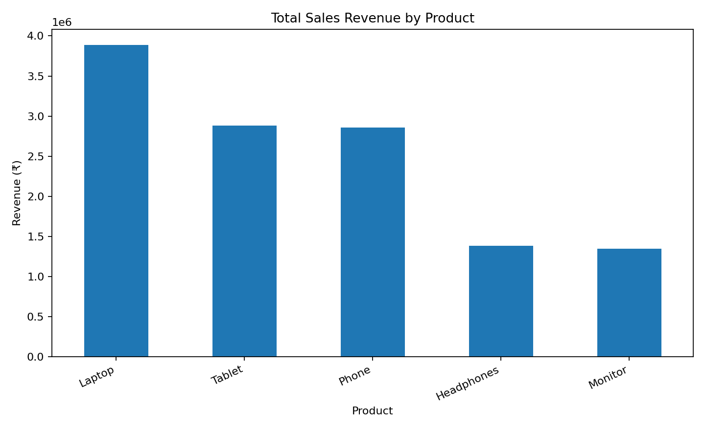
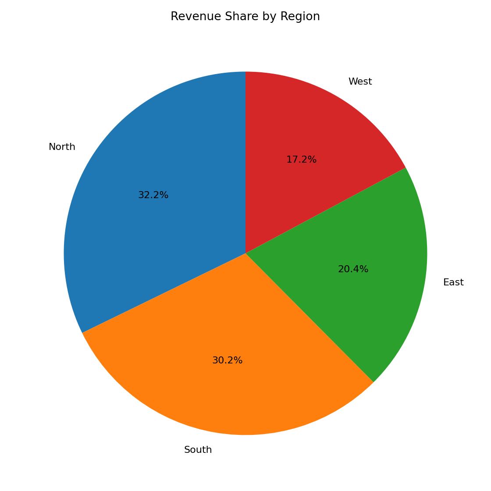
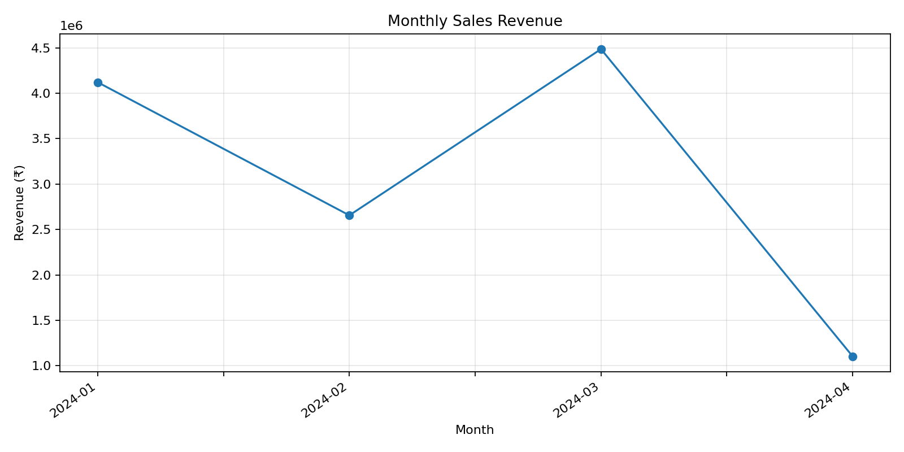

# Complete Sales Data Analysis

## 1. Project overview
This project uses pandas and Matplotlib to clean, analyze, and visualize the supplied sales dataset.

## 2. Dataset and cleaning
- Original rows: **100**
- Duplicate rows removed: **0**
- Rows removed due to unusable required values: **0**
- Rows analyzed: **100**
- Missing cells after cleaning: **0**
- Required columns are validated before analysis.
- Text fields are trimmed; numeric fields are converted to numeric types.
- Missing sales values are recalculated from quantity × price when possible.
- Rows without the fields required for reliable sales analysis are removed.

## 3. Key metrics
- **Total revenue:** ₹12,365,048.00
- **Average sale per row:** ₹123,650.48
- **Highest sale:** ₹373,932.00
- **Lowest sale:** ₹6,540.00
- **Top product by revenue:** Laptop (₹3,889,210.00)
- **Top product by quantity:** Laptop
- **Top region by revenue:** North

## 4. Revenue by product
| Product | Revenue | Units sold |
|---|---:|---:|
| Laptop | ₹3,889,210.00 | 136 |
| Tablet | ₹2,884,340.00 | 127 |
| Phone | ₹2,859,394.00 | 101 |
| Headphones | ₹1,384,033.00 | 48 |
| Monitor | ₹1,348,071.00 | 66 |

## 5. Revenue by region

| Region | Revenue |
|---|---:|
| North | ₹3,983,635.00 |
| South | ₹3,737,852.00 |
| East | ₹2,519,639.00 |
| West | ₹2,123,922.00 |

## 6. Visualizations
- 
- 
- 

## 7. Insights
1. **Laptop** generated the highest revenue in the dataset.
2. **Laptop** had the greatest total quantity sold.
3. **North** was the highest-revenue region.
4. The product bar chart makes revenue differences easy to compare; the regional pie chart shows each region's share of total revenue.

## 8. How to run
1. Install Python 3.9 or newer.
2. In the project directory, run `python -m pip install -r requirements.txt`.
3. Run `python main.py`.
4. Review `report/analysis_report.md` and the charts in `visualizations/`.

## 9. Code structure
- `main.py`: pipeline orchestration and error handling.
- `data/sales_data.csv`: source dataset.
- `visualizations/`: generated chart images.
- `report/analysis_report.md`: generated written report.

## 10. Testing evidence
- Dataset shape and required columns are checked by the code.
- Missing file and missing required columns produce clear errors.
- The analysis was run on the supplied dataset; see the metrics and generated charts above.
- For additional testing, try a CSV copy with duplicate rows, blank values, or an invalid numeric entry.

## Limitations
These findings describe only the supplied dataset and do not prove the causes of sales performance or predict future results.
